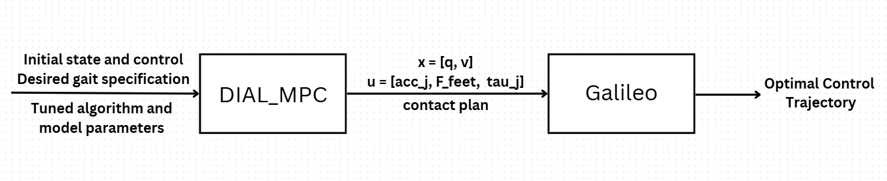

# DIAL-MPC + Galileo Integration

This branch connects the C++ **DIAL-MPC** controller (see the [`main` branch](https://github.com/laasyak02/dial-mpc)) to **[Galileo](https://arxiv.org/abs/2409.12465)**, a C++ framework for trajectory optimization and control of legged robots, on the **Unitree Go2**.

DIAL-MPC is a sampling-based controller: it finds good motions quickly, but its solutions are not exactly optimal. Galileo solves an optimization problem (a QP, using qpOASES) that normally starts from its previous solution. Here, DIAL-MPC's output is used as the **initial guess for Galileo's QP**, so the solver starts from a motion that already follows the desired gait.

<p align="center"></p>

---

## How it works

1. **DIAL-MPC** (`dial_mpc` package, `dial_simulate`) runs the Go2 in MuJoCo for the chosen gait. At each step it takes the optimized action and extracts from the MuJoCo simulation:
   - the joint accelerations,
   - the contact forces at the four feet,
   - the joint torques.
2. These are packed into one control vector `u = [acc, F_feet, tau]` (42 values) and published on the ROS topic `test_topic` as a `std_msgs/Float64MultiArray`.
3. **Galileo** (`galileo` package, `mujoco_test`) subscribes to `test_topic` and runs Galileo's whole-body controller on the Go2 in MuJoCo, with Pinocchio for the robot kinematics.
4. At each control step, the latest DIAL-MPC vector is passed into the whole-body controller and used as the **initial guess for the qpOASES solve** (`qpProblem.init(..., x0)` in `reactive/wbc-base.hpp`), instead of the solver's default start.

---

## Repository layout

| Path | Description |
|------|-------------|
| `ros1_ws/` | ROS1 (catkin) workspace with both packages. |
| `ros1_ws/src/dial_mpc/` | C++/Eigen DIAL-MPC for the Unitree Go2 in MuJoCo (`dial-core.h`, `unitree-go2-env.h`, `mujoco-sim.h`), plus a ROS publisher for its solution. Executable: `dial_simulate`. |
| `ros1_ws/src/galileo/` | Galileo, set up as a ROS package. Its whole-body controller takes the DIAL-MPC solution as the QP initial guess. Executable: `mujoco_test`. |
| `galileo/` | Standalone copy of the Galileo library used while getting it running in ROS. |

---

## Dependencies

- ROS1 (catkin) with `roscpp`, `std_msgs`, `geometry_msgs`
- MuJoCo and GLFW3
- Eigen 3
- Pinocchio
- qpOASES
- Boost, Gnuplot (plotting)

---

## Build & run

```sh
cd ros1_ws
catkin_make
source devel/setup.bash

roscore
# terminal 2: DIAL-MPC - simulates the Go2 and publishes its solution
rosrun dial_mpc dial_simulate
# terminal 3: Galileo - whole-body control warm-started with the DIAL-MPC solution
rosrun galileo mujoco_test
```

> **Note:** the MuJoCo/URDF model paths are hard-coded in `dial-core-simulate.cpp` and `mujoco-test.cpp` (e.g. `/root/dial-mpc-python/dial_mpc/models/unitree_go2/`). Update them to point at the Go2 models in your setup (the `models/` folder on the `main` branch) before building.

---

## References

- Xue et al. *Full-order sampling-based MPC for torque-level locomotion control via diffusion-style annealing.* [arXiv:2409.15610](https://arxiv.org/abs/2409.15610)
- Chandler et al. *Galileo: A pseudospectral collocation framework for legged robots.* [arXiv:2409.12465](https://arxiv.org/abs/2409.12465)
