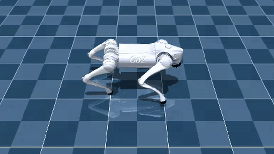
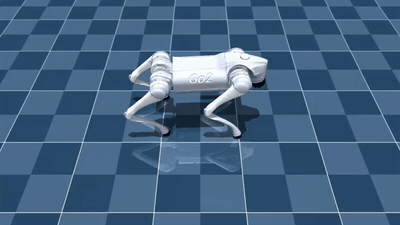

# DIAL-MPC for Legged Robots

A **C++/Eigen** implementation of **DIAL-MPC** (Diffusion-Inspired Annealing for Legged MPC) - a sampling-based model predictive controller for legged locomotion - with MuJoCo simulation and RViz visualization.

DIAL-MPC is a training-free, sampling-based controller: at each planning step it samples a batch of control sequences, rolls them out, and refines them over several annealed "diffusion" iterations (an MPPI-style update with a decaying noise schedule), producing smooth control trajectories for dynamic legged motion.

This repo ports the algorithm from Python to C++/Eigen and runs it on the **Unitree Go2** (quadruped) MuJoCo model.

<table align="center">
  <tr>
    <td align="center"><br><b>Walk</b></td>
    <td align="center"><br><b>Trot</b></td>
    <td align="center"><br><b>Stand</b></td>
  </tr>
</table>

<p align="center"><i>Unitree Go2 in MuJoCo, driven by the C++ DIAL-MPC for three gaits (400 timesteps each, 1.0 m/s commanded forward velocity for walk and trot).</i></p>

📄 **[Project report (PDF)](docs/DIAL_MPC_Report.pdf)** - method, implementation details and results.

---

## What's here

| Directory | Description |
|-----------|-------------|
| `dial_mpc/` | **ROS2 package** (`rclcpp`) - control-sequence generation, an RViz visualizer (`visualization_msgs`), and legged-robot inverse kinematics. |
| `dial_mpc_eigen/` | **Standalone C++/Eigen** implementation of the DIAL-MPC core and the Unitree Go2 environment, with MuJoCo + GLFW simulation. |
| `dial_mpc_eigen_plotting/` | Same as above, with added plotting of the control sequences. |
| `models/` | MuJoCo models for **Unitree Go2** (quadruped) and **Unitree H1** (humanoid), including MJX scene variants. |

---

## Method

The core (`dial_mpc_eigen/include/dial-core.h`) is a C++/Eigen translation of the reference Python DIAL-MPC, matching its math:

- **Sampling + annealing.** Each planning step samples `Nsample` candidate control sequences, rolls them out, and runs `reverse_once` several times (`Ndiffuse` iterations, more on the first step) to refine toward the best sequence. The sampling noise `σ_control` is scaled by a diffusion factor that decays over iterations (annealing).
- **MPPI update.** Rollout rewards are normalized across time and turned into softmax weights (temperature `temp_sample`) to form the updated control sequence.
- **Spline-parameterized controls.** Control sequences are represented at a small set of node points and expanded to the full horizon with **piecewise cubic Hermite interpolation**, keeping the commands smooth.

Default configuration (from `DialConfig`): horizon `Hsample = 16`, `Hnode = 4` node points, `Nsample = 20` samples, `ctrl_dt = 0.02 s`.

### Environment

The Unitree Go2 environment (`unitree-go2-env.h`) wraps MuJoCo physics with a PD joint controller (`kp = 30`, `kd = 1`) and tracks commanded body velocities (`vx, vy, vyaw`). Rendering is done through GLFW.

---

## Results & Galileo integration

- **Gaits:** DIAL-MPC was run for stand, walk and trot for 400 timesteps each. Base-position plots show the robot holding position while standing, and steady forward motion along X with little drift in Y for walking and trotting (walking was the smoother of the two). Plots are in the [report](docs/DIAL_MPC_Report.pdf).
- **Galileo:** the goal is to use DIAL-MPC's solution as a warm start for [Galileo](https://arxiv.org/abs/2409.12465), a pseudospectral trajectory optimizer for legged robots. Joint torques, contact forces, joint accelerations and the contact plan are extracted from the DIAL-MPC rollout, and DIAL-MPC and GalileoV2 run as ROS nodes, with DIAL-MPC publishing its solution for Galileo to subscribe to. Feeding these values into Galileo's QP solver as the initial guess, and measuring the effect on convergence, is the next step.

---

## Dependencies

- **MuJoCo** (physics + rendering)
- **Eigen 3.3+** (linear algebra, cubic-spline interpolation)
- **GLFW3** (visualization window)
- **ROS2** + `rclcpp`, `std_msgs`, `geometry_msgs`, `visualization_msgs` - for the `dial_mpc` ROS2 package only
- A C++ toolchain with CMake

---

## Build & run

**Standalone Eigen version:**
```sh
cd dial_mpc_eigen
mkdir build && cd build
cmake ..
make
# run the DIAL-MPC simulation / tests, e.g.
./dial-core-simulate
```

**ROS2 package:**
```sh
# from your ROS2 workspace (with dial_mpc in src/)
colcon build --packages-select dial_mpc
source install/setup.bash
ros2 run dial_mpc control_sequence            # generate the control sequence
ros2 run dial_mpc control_sequence_visualizer # visualize in RViz
```
---

## References

- Xue et al. *Full-order sampling-based MPC for torque-level locomotion control via diffusion-style annealing.* [arXiv:2409.15610](https://arxiv.org/abs/2409.15610)
- Chandler et al. *Galileo: A pseudospectral collocation framework for legged robots.* [arXiv:2409.12465](https://arxiv.org/abs/2409.12465)
- Unitree Go2 / H1 MuJoCo models — [MuJoCo Menagerie](https://github.com/google-deepmind/mujoco_menagerie)

---
